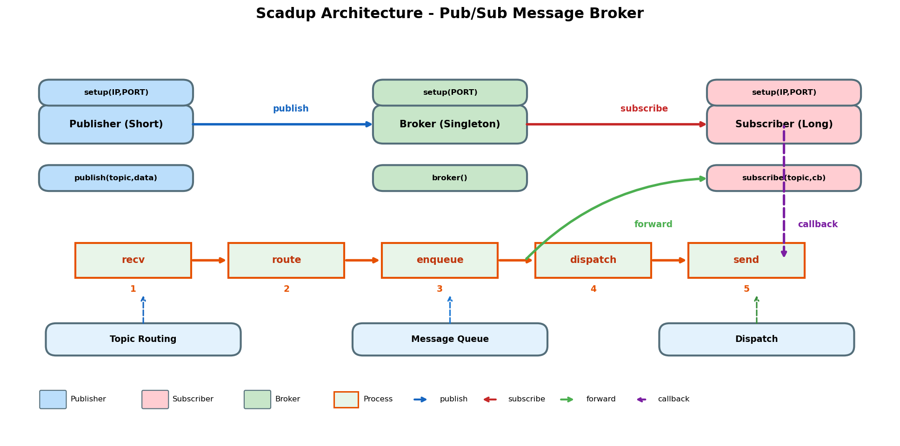

# Scadup

**S**hare **c**ommand **a**nd **d**ata under _`scadup`_ **p**roxy

A lightweight Pub/Sub message broker system.

## Quick Start

```bash
./make.sh                                   # builds build/test/scadup.exe + target/lib/libscadup.*

./build/test/scadup.exe 1                   # broker (blocks)
./build/test/scadup.exe 2 1234              # subscriber on topic 0x1234
./build/test/scadup.exe 3 1234 "Hello!"     # publish (broadcast)
./build/test/scadup.exe 3 1234 -f file.txt  # publish file content
./build/test/scadup.exe 3 1234 "Hi" 0x050010ac   # publish to one subscriber
```

Run it from `build/test/`, where `scadup.cfg` is copied next to the binary.

## Architecture

```
Publisher ──┐            ┌─── Subscriber
Publisher ──┼──▶ Broker──┼─── Subscriber
Publisher ──┘            └─── Subscriber
```



## Core API

```cpp
// Broker
Broker::instance().setup(9999);
Broker::instance().broker();   // blocks until exit()

// Subscriber
Subscriber sub;
sub.setup("192.168.1.100", 9999);
sub.subscribe(0x1234, [](const Message& msg) {
    printf("%s\n", msg.payload.content);
});

// Publisher: setup() once, publish() as often as needed
Publisher pub;
pub.setup("192.168.1.100", 9999);
pub.publish(0x1234, "message");
```

A payload may be up to `MAX_PAYLOAD` (4 MB) and may contain zeros: `content` is
NUL-terminated, so read `msg.payload.length` bytes from it instead of relying on
`strlen()`.

## One-to-one (unicast)

`dst == 0` (default) broadcasts to every subscriber of the topic; anything else targets a
single subscriber, either by the id it registered or by the ssid the broker assigned it:

```cpp
pub.publish(0x1234, "just for you", 0x050010ac); // by id: 172.16.0.5, as inet_addr() packs it
pub.publish(0x1234, "just for you", sub.ssid()); // by ssid
```

`setup()` registers the local address of the connection as the subscriber's id
(`Subscriber::dstId()`), which is the address the broker sees for that peer — in network
byte order, i.e. the value `inet_addr()` returns for its IP; pass `dstId` to
`subscribe()` to register anything else. `publish()` returns the bytes written
and `delivered()` reports how many subscribers were reached; the broker answers
`CMD_ERROR` when a unicast target matches nobody.

## Relay model

* One thread per connection, so a slow or stuck peer cannot block the accept loop or
  other peers.
* The first header a peer sends is a registration handshake: it must echo the ssid the
  broker assigned at accept time and declare `PUBLISHER` or `SUBSCRIBER`. A peer that
  never registers is dropped after 3 s instead of stalling the accept loop. Afterwards
  the handler tolerates idle timeouts, so a live connection is never dropped for being
  quiet.
* Publisher connections are persistent — `quit()` or the destructor closes them.
* Framing is `[Header][status][content]`, with `Header::size` covering all of it. Reads
  are exact-length, so a truncated frame is detected and dropped instead of
  desynchronising the stream.
* Writes to a subscriber are serialised by a per-peer lock and never by a global one, so
  different subscribers are written to concurrently. A peer that stops reading is dropped
  after a send timeout rather than blocking a publisher.
* Subscribers do not poll: `recv()` blocks until a whole message arrives.
* Idle helpers that fell out of use live in [`src/utils/common.h`](src/utils/common.h).

## Lifecycle

* `broker()` returns `0` on a normal exit and `-1` only when the listening socket itself
  is gone. A single failed `accept()` — a peer that aborted the handshake, a transient
  `EMFILE` — is logged and retried, so one bad connection cannot silently stop the broker.
* `exit()` closes the peer sockets and the listener. Call it from a thread other than the
  one running `broker()`; the accept loop is written to survive the listener being closed
  underneath it, and polls with a 200 ms `select()` timeout so it returns within ~200 ms.
* Restart is supported: `setup()` → `exit()` → `setup()` on the same port works because
  the listening socket sets `SO_REUSEADDR`. That option is POSIX only — on Windows it
  also acts as `SO_REUSEPORT` and would let another process take over the port.
* `Subscriber::setup()` clears the static flags left by the previous round (`m_exit` and
  the global abandon flag), so one process can run several subscribe → stop → subscribe
  sessions. Stop and start must not overlap: let `quit()` / `exit()` finish first.

## Configuration

`scadup.cfg`:

```ini
IP=192.168.1.100
PORT=9999
```

## Build

```bash
./make.sh                                        # Linux / macOS
make.bat                                         # Windows (cmd / PowerShell)
cmake -DANDROID=1 -DANDROID_ABI=arm64-v8a ..     # Android
```

For Windows the build links `WS2_32` automatically. Winsock is started once per process
(`WSAStartup` in `Scadup::makeSocket`); socket handles are unsigned, so validity is tested
with `sockValid()` / `INVALID_FD` rather than `< 0`, and errors are read through
`SOCK_ERRNO` + `sockError()` (`WSAGetLastError()` + `FormatMessage`) instead of `errno` +
`strerror`.

## Usage

* Test case: [test](test)
* Example project: [Device2Device](https://github.com/tsymiar/Device2Device/tree/main/app/src/main/cpp)
